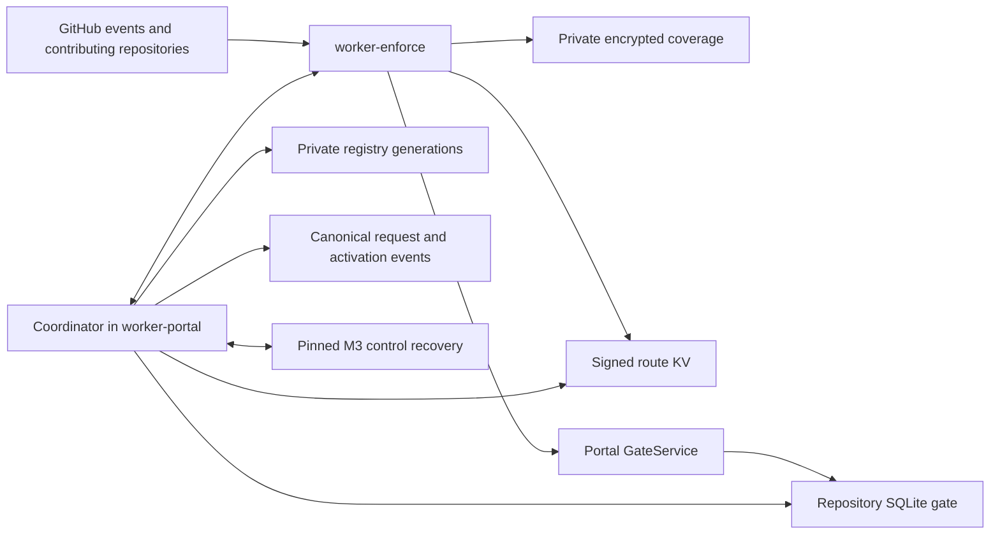

# M4 — Enforcement and routing architecture

Status: architecture draft with the owner-approved public contract. Human
architecture approval and the detailed plan, slices and LOC estimates remain
separate gates. Nothing in this document asserts a deployed service or
production acceptance.

## 1. Outcome and governing contracts

M4 implements the complete [M4 requirements](requirements.md): ordinary PR
feedback, authoritative ALLGREEN merge-queue checks, the default-branch
post-landing fallback, routing and its strongly consistent publication boundary,
and actual recovery integration. The [product requirements](../requirements.md),
[product HLD](../high-level-design.md) and
[M3 recovery design](../lld/m3-control-reconciler.md) remain governing inputs.
Their scope, action authority and cryptographic formats are retained.

The selected design has two Workers. `worker-enforce` owns enforcement and
contributing-repository observations. The coordinator inside `worker-portal`
owns registry derivation, route signing and repository gates. GitHub canonical
events remain CLA and administrative truth; the private registry is the
coordination-domain snapshot, signed KV its runtime projection, and each gate
contains only bounded operational routing/publication state.

This preserves the declared serverless-enforcement deviation from `REQ-OPS-2`.
There is no third Worker, durable queue, application database, reverse PR index,
full replay at the edge or second conformance corpus. M5 adds authenticated
portal flows over these services; M6 installs them; M7 supplies release-wide
measurement and acceptance. None of those milestones absorbs unfinished M4
enforcement or recovery behavior.

## 2. Existing code and added responsibilities

| Component | Existing primitive | M4 addition |
|---|---|---|
| Coverage decision | `api/src/conformance/coverage.ts` validates full projections and evaluates subjects | Authenticated immutable required-shard observation; share the same semantic decision rule, without fabricating unobserved shards |
| Publication fence | `api/src/conformance/operations.ts` supplies identities and pure success transitions | Portal-owned exact coverage-fence CAS service, enforcement check publisher and independent completion driver |
| Records recovery | `core/dracla/records/{history,append,reconcile}.py` and M1 replay | Authenticated routing/publication adapters and control-job integration; reuse the engine |
| Scope truth | M1 replay exposes effective scope and request/terminal relations | Registry coordinator validates exact canonical request/terminal packages and continuity; no new current-scope truth store |
| Runtime | TypeScript conformance package; `api/wrangler.toml` currently launches an A2 benchmark | Separate production Worker configurations, bindings, entrypoints and actual Worker/SQLite integration harness |
| GitHub provisioning | M2 administration interfaces | Consume verified runtime assignments; keep provisioning authority in M6's administrator path |

The current `coverageProjection` constructor requires all 37 plaintext files.
It is not a bounded hot-path reader. M4 adds a read-only observation type that
owns the five control files and exactly the required packed shards from one
commit, validates every fetched member, and rejects attempts to evaluate an
unobserved subject. Extract shared decision/validation helpers rather than
maintaining two decision implementations. Python reference behavior and the
existing corpus remain authoritative; add parity cases there when needed.
Mutable full-projection APIs retain their complete-observation requirement.

## 3. Deployment and capability boundaries



`worker-enforce` holds its App identity/private key, its route-specific webhook
secrets, coverage wrapping roots, accepted route verification keys, route KV
read access, the narrow gate-service binding and an exact coverage-fence
reserve/release binding to the portal. It has no records key,
records-App key, registry write token or Durable Object namespace binding.

`worker-portal` holds records capabilities, registry write access, route signing
keys and the gate namespace. It has no enforcer App key. M4 code in this Worker
does not expose its namespace-transition or records capability through the
enforcement entrypoint. Records webhook verification uses its own route and
secret set, never the enforcer route's secret.

Use named, non-public `WorkerEntrypoint` service bindings. Public `fetch`
routing does not forward to internal RPC. The narrow gate entrypoint exposes
only compare/reserve/confirm. A separate private coverage-fence entrypoint
executes only exact reservation/release CAS using the portal's existing
coverage-write authority. It exposes no raw token, arbitrary path/plaintext
write, records operation or namespace transition. A report-only entrypoint
accepts
doorbells, without returning or mutating namespace state on behalf of its
caller. The reverse observation entrypoint in `worker-enforce` returns
request-bound facts, never a token. Internal coordinator transition functions
are ordinary portal-private code, not remotely exported methods.

Cloudflare's [service-binding RPC](https://developers.cloudflare.com/workers/runtime-apis/bindings/service-bindings/rpc/)
supports named entrypoints. Bind the exact entrypoint and await calls whose
completion is needed; a public URL or a caller-supplied entrypoint name does
not grant this capability. Each gate uses
[SQLite-backed Durable Object storage](https://developers.cloudflare.com/durable-objects/api/sqlite-storage-api/),
with local synchronous transactions. External GitHub, KV and registry I/O
occurs outside those transactions. A failed call or quota exhaustion denies
progress; it is never an absent-row match.

App permissions are the approved inventory in
[the setup guide](../../docs/github-apps.md). `push` and Issues write are
required for the fallback. GitHub grants accepted repository permissions across
installation-selected repositories, including selected coverage repositories.
Every normal token names exact numeric repository IDs and minimum permissions;
coverage tokens in enforcement request only contents read. The portal's
fixed fence-CAS operation uses an exact-coverage-repository contents-write token
under its existing App grant. No enforcer App permission is added. This narrows
ordinary execution,
not the reach of an exposed App key. No permission or live installation is
changed by approving this architecture.

## 4. Public interface and user behavior

### 4.1 Webhook interface

The existing configured endpoint is:

```text
POST https://<enforcement-origin>/webhook/enforcer
X-Hub-Signature-256: sha256=<HMAC of exact request bytes>
X-GitHub-Event: <supported event>
X-GitHub-Delivery: <delivery identifier>
```

Verify bounded raw bytes before JSON parsing or body-based routing. Select only
this App's current/retiring secrets; use constant-time verification and reject
SHA-1. During same-App rotation accept the explicitly configured overlap, then
retire it. Delivery IDs support idempotency, not age or ordering claims.

Accepted events are PR `opened`, `reopened`, `synchronize` and supported
re-requests; merge-group `checks_requested`; this App's exact authoritative
check completion; default-branch pushes; and subscribed repository,
installation and membership lifecycle doorbells. Unsupported authenticated
actions are ignored. Invalid signature returns `401`; malformed/oversized
input returns `400`/`413`; a completed or harmlessly ignored delivery returns
`204`. A transient failure before processing completes returns `503` and emits
a safe category/correlation identifier. Returning `204` is not a durable job
receipt. Do not acknowledge unfinished work on the assumption that GitHub will
automatically retry it. Daily recovery and operator redelivery remain explicit.

### 4.2 Check, comment and issue contract

Use one configured fixed check name, `DraCLA`, pinned consistently in Worker
configuration, installer guidance and adopter required-check configuration.
Ordinary feedback uses `dracla-ordinary-v1.` external IDs. Authoritative IDs use
the existing exact `dracla-authoritative-v1.` identity contract; the namespaces
are disjoint. Internal IDs do not contain subject names or record values.

| Evaluation | GitHub state | Fixed public wording |
|---|---|---|
| Current coverage | completed / success | `CLA satisfied` |
| Missing coverage, unresolved authors or incomplete subject listing | completed / failure | `Action required. Open the authenticated CLA portal, push a new commit, or re-request this check.` |
| Valid overlapping mutation still progressing | in_progress | `Temporarily unavailable. Open the authenticated CLA portal or re-request this check.` |
| Unavailable, bounded retry exhausted or intervention needed | completed / failure | Same temporarily-unavailable wording |
| Exact repository conflict | completed / failure | `Action required: this repository is covered by more than one CLA project; an administrator must resolve it.` |

Use the same fixed table for the required PR comment. Bounded lookup updates an
existing comment only after verifying this App's author identity and exact PR;
an untrusted comment marker never authorizes editing another author's comment.
Do not emit annotations containing private detail, names, counts or mentions.
Escape URLs and all untrusted text; derive portal destinations from validated
routes and the configured HTTPS origin, never a request-supplied redirect.

A PR link has the existing shape
`/p/<repository-owner>[/<project-slug>]/pr/<number>`. For example,
`https://<portal-origin>/p/acme/widget/pr/42` requires authentication. M5 owns
the graded view: own status for an authenticated viewer, aggregate reasons for
current repository writers, named numeric-ID/login details only for current
records readers. This milestone adds no public reason or signer lookup API.
Conflict output links to an authenticated repository-control view that selects
no project. M5 defines its form/UI under the existing admin-only inspection rule.

The fallback issue title is `DraCLA: <commit SHA>`. Its body contains that SHA,
one of the fixed generic states, and a validated authenticated-portal link.
No subject, count, reason, project-conflict list, scope entry or hidden private
metadata is included. Bounded App-authored exact-SHA lookup suppresses ordinary
duplicate deliveries; GitHub issue creation is not an atomic unique insert, so
simultaneous or lost-response retries can leave duplicate generic issues. Do
not add a persistent deduplication database to claim exactly-once output.

### 4.3 Defaults, retries and compatibility

The default blocking subjects are opener plus every GitHub-resolved commit
author, deduplicated by numeric ID. Trailer co-authors remain advisory unless
the existing project policy explicitly enables blocking them. No signed-commit
requirement is introduced. Agreement/version, exemptions and exact PR/root-tree
overrides combine only as the existing M1 rule permits; a mutation fence is
applied first. An active override does not bypass the freshness boundary.

Only ALLGREEN is supported for authoritative queue checks. Ordinary checks
without a required queue are early feedback. A later record change does not
rewrite a completed queue decision; a rebuilt entry or new checks-requested
delivery evaluates afresh. Administrators retain their GitHub-configured bypass.

There is no public reset/unlock API. Re-requesting re-evaluates current state;
it cannot expire a reservation. Signing from a PR lets M5 request that exact
originating PR's reevaluation. A new head supersedes ordinary feedback without
reusing an old content override. An unmet dependency or stale source fails
closed. Offboarding creates no final passing check and does not edit branch
rules; M5 warns the administrator to remove any still-required check.

Initial production configuration must supply both Worker origins, exact App
IDs, accepted key IDs, registry identity, KV and named service/DO bindings.
Benchmark configuration is not a production default. M6 consumes this explicit
contract and confirms the `DraCLA` required-check name/App, ALLGREEN where used,
fallback permissions and issue availability. Existing encrypted data, fixed
32-shard layout, key history and canonical events require no conversion.

### 4.4 First-connection boundary

The shared canonical writer also owns the first Connect's durable operation.
M6 prepares exact root/K/B/manifests and independent idle guards, without a full
semantic coverage or private derived generation. M5 supplies current installed
authority/key proofs and the existing `generations-absence` precondition. The
same M4 executor authenticates those narrow bootstrap inputs, prepares/fences/
opens, appends the real event/config once, then builds complete normal coverage
and private derived state before terminal/readback/release. It does not invent
an active before-state or accept an unconnected coverage format. An interrupted
owned first operation uses existing exact-package M3 recovery; connected actions
and enforcement still require fully valid current projections. No route is
published by this append; the requested/activated scope protocol follows.

### 4.5 Later replacement-recovery integration

Global §9.1.1 defines the owner-approved prospective schema2 repository rebind.
M6 owns that later extension to the existing shared writer, origin-aware Python
recovery and route integration; M4 supplies its ordinary executor, current
transition/quarantine adapters and real harness first. M4 does not build another
writer or assume replacement recovery is already supported. Exact mirror copying
preserves broken/incomplete state without repair; new targets stay unbound and
current source routes stay unchanged during read-only health checks and unhealthy
denial. Separate explicit activation requires a healthy idle source and all
initial-installation proofs. After current authority/heads and confirmation,
conditionally stage the exact registry/gates and revalidate before keys/jobs or
the new rebind. Only that activation's own accepted operation can retry. Complete
only its exact staged generation after canonical rebind, full materialization/
readback and sweep; a newer quarantine wins. A new numeric
repository ID, backup or alias is never an ordinary route/binding shortcut.
Existing same-ID owner transfer, connected recovery and initial Connect retain
their contracts. Unsupported rebind schemas deny until compatible M6 code is
installed; later acceptance must exercise the actual M4 services and all original
installation proof requirements, not replace them with a success flag.

## 5. PR and coverage journey

1. Authenticate the event. Resolve the stable numeric repository key in signed
   KV, verify its accepted signing key and unsigned canonical-payload digest,
   and compare the exact state/generation/registry OID/digest at the gate.
   Event repository/owner/name/installation mismatch can invalidate, never
   select a replacement project. Verified unmanaged state yields no check.
2. With the one validated active route, acquire an exact contributing-repository
   token. Re-read the PR and completely enumerate commits, including opener and
   resolved authors. Enforce the endpoint's 250-commit bound and all page/budget
   limits. Resolve the exact current head's Git root tree OID. Partial,
   unresolved or changing identity cannot pass.
3. Resolve coverage head `C` once. Authenticate selected wrapped-key metadata
   and every envelope's project/purpose/path/key binding. Read source, fence,
   marker, active agreement, exemptions and each needed shard exactly once at
   `C`. Validate source lifecycle and fence/marker correspondence, including
   legitimate marker absence before open/after close. Never fetch moving refs
   for later members or synthesize missing shards.
4. Apply fence first. A project-wide or overlapping mutation yields pending;
   unrelated ordinary subjects and valid success reservations may be evaluated.
   Then apply effective exemptions, accepted-version coverage and exact
   repository/PR/subject/root-tree overrides. No exemptions' private sources
   cross into enforcement.
5. Recheck the ordinary PR head before writing. Publish the generic check and
   comment only for the evaluated head. An older invocation cannot replace a
   new head's result. Uncertain writes are recovered by exact App/head/external
   identity, not blindly retried as new success.

A succeeded lifecycle does not fall back to active; use only its independently
validated successor route and public link. Unknown lifecycle or key selection
is unavailable. Logs retain safe delivery/category/OID evidence, never subjects
or plaintext. Git author attribution remains attacker-controlled metadata;
signed committers alone would not prove every author's consent. Attribution,
griefing and aggregate-check oracle risks remain documented residual risks.

## 6. Authoritative queue and fallback journeys

### 6.1 Queue decision and publication

Normalize only canonical `refs/heads/<branch>` base refs. Query the official
`repository.mergeQueue(branch: ...)`, configuration and first 100 entries.
Require ALLGREEN, a supported build window and exactly one entry whose
`headCommit.oid` equals the event head, with one non-null PR and consistent
repository/base facts. Do not parse synthetic branch names or aggregate all
earlier PRs in its tree. Resolve that PR's subjects/head/root tree afresh and
run §5's immutable coverage evaluation with an idle fence.

Derive the existing deterministic identity from repository, merge-group head,
PR and delivery. Ask the private portal coverage-fence service to CAS the exact
idle coverage fence at `C` to its success reservation. Then reserve publication
at the exact active route gate. Only while both are held create the authoritative check directly as completed
success. Validate the response's App, external identity, head, status and
conclusion; ask that service to release only the matching coverage reservation.
The routing
reservation remains until an independent authenticated completion webhook or
bounded exact GitHub read confirms the terminal check.

If the coverage CAS loses, restart or return non-passing. If routing reservation
loses, complete the exact non-passing recovery path before releasing coverage.
A lost create response retains the acquired reservations. Bounded recovery
lists at most 100 exact App/name/head authoritative candidates: one match is
read back and confirmed/completed; zero creates and reads back a non-passing
terminal check; duplicates, truncation or ambiguity retain reservations for
operator reconciliation. Clearing follows the separate coverage/gate methods;
neither elapsed time nor a missing marker authorizes it.

### 6.2 Default-branch fallback

Enter this journey only after raw-body enforcer authentication and the same
signed-route, authenticated event/repository/installation comparison and exact
gate comparison as §5, before any project coverage access or issue write.
Verified unmanaged state does nothing. Conflict, pending and unavailable states
use only §7.1's bounded no-project output capability; they do not pick a project
for fallback evaluation. Unknown installation or failed gate access grants no
repository token by guess.

Determine the current enforcement mode from live GitHub observations for the
exact numeric repository and current default branch, not a webhook flag, an
installer assertion or a persisted per-PR success. Read the official
`repository.mergeQueue(branch: ...)` object/configuration and the complete
active rules for that branch. The
[branch rules endpoint](https://docs.github.com/en/rest/repos/rules#get-rules-for-a-branch)
returns active repository/organization rulesets with metadata-read authority.
Classic protection is a separate observation through the branch's
[GraphQL protection fields](https://docs.github.com/en/graphql/reference/git#ref)
and [required check descriptions](https://docs.github.com/en/graphql/reference/branches#requiredstatuscheckdescription).
Do not assume the ruleset endpoint represents classic protection, or that a
null/hidden/errored field proves absence. An existing ALLGREEN queue plus an
effective required `DraCLA` check bound to the expected App is required-queue
mode: skip post-landing coverage reevaluation and issue creation, preserving
that landing attempt's completed authoritative decision after later record
changes. A verified absence of an applicable required queue selects the
fallback. HEADGREEN, conflicting observations, access failure, incomplete pages
or an inability to distinguish absent from inaccessible configuration is
indeterminate; publish only bounded unavailable output when authorized and
raise an operator category, with no project coverage access or fallback issue.

The mode observation is bound to repository, branch and this invocation; it is
not cached as authorization or used as a new registry truth. Revalidate it and
the exact route/gate immediately before a fallback issue write. A changed mode
restarts classification; a now-required queue suppresses the issue. GitHub
configuration is externally controlled, so this is an observed-mode decision,
not a transaction with GitHub's administrator settings. LLD must specify the
closed observation/permission/absence checks, and real-account acceptance must
cover classic/ruleset configurations, inaccessible fields, queue enable/disable,
ALLGREEN/HEADGREEN and a completed queue decision followed by revocation. No
new administration permission or signed local configuration shortcut is implied.

Once no-required-queue mode is proved, resolve current default branch and
numeric identity, then enumerate the complete introduced commit set
between immutable `before` and `after` OIDs using bounded GitHub observations.
The webhook's commit array alone is not completeness evidence. A deletion,
force-push divergence, missing ancestry or exceeded budget is incomplete, not
an empty successful set. It emits the bounded unavailable alert for the event's
`after` commit where valid and a safe operator recovery category.

For each introduced commit, use GitHub's associated-PR endpoint and require an
exact unambiguous merged-PR association when present. Evaluate that PR's opener
and complete authors, with its immutable head/root-tree binding. For a verified
direct push with no associated PR, evaluate its GitHub-resolved author and use
no PR override. Ambiguous or incomplete association is unavailable. Do not
infer a PR from text or treat unresolved identity as covered.

Reverification observes current coverage when the push is handled; it is not
historical proof of CLA status at the instant of landing. If the decision is
action required or unavailable, create the fixed issue described in §4.2.
Ignore other refs after authentication, but account for their incoming request
cost. A project coverage update can itself generate an ignored push delivery.
Each commit evaluation uses the same route/gate and immutable coverage
boundaries, and may use a bounded service invocation; exhaustion never
labels the unprocessed remainder covered. Issues disabled, permission not yet
accepted, quota failure or ambiguous create leave fallback incomplete and emit
a safe operator category; do not enable issues or alter repository settings.
This detects problems after landing and cannot prevent a merge.

## 7. Coordinator and gate contract

### 7.1 Narrow interfaces

The following signatures define internal capability boundaries. Their typed
closed records use existing IDs/digests; LLD resolves exact encodings and
limits. They are not public HTTP endpoints or arbitrary method dispatch.

```typescript
interface GateService {
  compare(route: RouteIdentity): Promise<'match' | 'deny'>;
  reservePublication(check: CheckIdentity, route: ActiveRouteIdentity): Promise<ReservationResult>;
  confirmPublication(check: CheckIdentity, observed: TerminalCheckObservation): Promise<ConfirmResult>;
}
interface CoverageFenceService {
  reserve(route: ActiveRouteIdentity, coverageCommit: GitOid, idleFenceBlob: GitOid, check: CheckIdentity): Promise<CoverageReservationResult>;
  release(held: CoverageReservationIdentity, observed: TerminalCheckObservation): Promise<CoverageReleaseResult>;
}
interface RoutingDoorbell {
  changed(repositoryId: RepositoryId, trigger: VerifiedTrigger): Promise<void>;
}
interface EnforcementObservations {
  repositoryFacts(challenge: RepositoryChallenge): Promise<RepositoryFacts>;
  publication(challenge: PublicationChallenge): Promise<PublicationObservation>;
  reevaluate(repositoryId: RepositoryId, pr: number): Promise<ReevaluationResult>;
}
```

`CoverageFenceService.reserve` independently validates the exact active route,
resolves that one project and its fixed coverage repository/fence path, validates
commit/cell/marker/key binding and performs only the existing idle-to-reserved
CAS. The caller cannot supply arbitrary paths or plaintext. `release` validates
the exact held reservation and trusted enforcement terminal-check observation.
It can release that reservation even after a route transition won, without
accessing a replacement project. Lost RPC responses use exact coverage-fence
readback and idempotent recovery; no extra receipt store or fence schema is
introduced. Both operations use the portal's existing narrow coverage-write
token, never export it, and expose no records or namespace mutation. The normal
path adds one reserve and one release RPC; include their costs and every crash
boundary in platform measurements and estimates.

`compare` returns no project or route. `confirmPublication` is called only
after the trusted enforcement handler independently authenticates the exact
terminal check; caller-provided HTTP JSON cannot construct that capability.
Reject other App IDs, ordinary/unknown namespaces, head mismatches and
incomplete observations before RPC. An observation challenge binds the exact
request, repository, installation, purpose and current route/transition; stale
or cross-purpose replies cannot activate a generation. Permission probes for
M5 bind the viewer and exact repository and return only the existing signed
short-lived yes/no assertion, never an installation token or repository data.

No-project control requires one current verified covering installation and
exact repository-token binding. It may emit fixed conflict/pending/unavailable
output, but access neither project's repositories nor keys. Only matching
conflict permits a fresh current-admin inspection probe. Inspection never
authorizes a resolution mutation. Unknown installation produces no guessed
token and leaves the repository unavailable.

### 7.2 Derivation and administrative transition

The coordinator reads a complete immutable registry generation, validates every
project binding and the complete selector set, and obtains request-bound current
GitHub facts. Numeric identity anchors rename/transfer handling. Claims remain
owner-ID/slug scoped; project repositories must share the authenticated owner.
Write-created overlap is rejected. GitHub-created overlap quarantines only the
affected repository; no precedence rule selects a winner.

Canonical scope and owner changes are validated against exact request and
deterministic activation/abandonment paths in an authenticated events snapshot.
The prepared registry generation exists before activation, records its request
and prior-generation continuity, and cannot route merely because it exists.
Follow every unresolved prepared request from registry history to its terminal
paths; validate the complete chain back to an already validated generation.
An unregistered request cannot affect routing until preparation. A cold or
incomplete chain cannot be trusted from a last-event guess: retain unavailable
and use the existing M3 full replay/reconciliation path to authenticate it.
LLD must resolve the bounded direct-read/registry-continuity adapter and its
M3 external-evidence provider; no current-scope projection is assumed to exist.

For an authorized change: prepare the immutable registry generation and signed
`prepared/<generation>/<repository_id>` entries; put every changed repository
gate pending; recheck the same live action authority; append the exact canonical
activation; publish/revalidate stable signed KV entries; conditionally commit
the matching gates; request affected open-PR reevaluation. M5 supplies actor
authentication and confirmation; the coordinator cannot invent it.

All affected gates must acknowledge pending before activation. Partial failure
before activation restores only its own pending rows after proving no
activation, or leaves them pending. Activation and abandonment use the existing
mutually exclusive deterministic children. After activation, finish exactly
that generation forward; rollback is a new authorized change. A move removes
the old binding and activates that generation before binding the new project.

### 7.3 Gate representation and lifecycle

The SQLite object name derives from numeric repository ID. Store only the
product HLD §7.2 row: stable routing identity/state; exact transition and
prepared identity with prior row while pending; or one publication identity,
route digest and operational timestamps while active. No signer, agreement,
exemption, scope list, coverage or records data is stored there.

Implement exact conditional `begin_pending`, `reserve_publication`,
`confirm_publication`, `commit`, `restore` and unavailable transitions. Explicit
absent-row is a valid first-bind expectation, not a substitute for read error.
Identical retries return the same row; stale/different complete expectations
conflict. Pending and publication fields cannot coexist. Timestamps are
diagnostic only. No external I/O occurs in a gate transaction.

Signed KV uses stable `routes/<repository_id>` keys. Verify signature `kid`
separately from SHA-256 of canonical unsigned semantics. A route is usable
only with matching state, generation, registry OID, digest and installation.
Rotating only a signature does not change semantic digest or gate generation.
Old KV or cached misses delay service but never select an old project.
Unchanged derivations perform no gate/KV writes.

Lifecycle doorbells first invalidate the affected gate, then reread current
facts and run the same derivation as the daily reconciliation schedule.
Deletion retains a numeric-ID tombstone; restoration rematches from scratch.
Partial project-repository transfer stays unavailable until M5's explicit
owner migration completes. An unchanged unaffected repository can retain its
older matching row even when the global registry advances.

Reconstruct an empty gate only from complete registry/current GitHub facts and
the exact enforcer-side coverage-fence observation. A matching success
reservation reconstructs publication fields. Non-idle, ambiguous or unavailable
evidence leaves the gate unavailable. Independent self-hosted deployments have
separate coordination domains; cross-domain double-targeting remains unsupported.

## 8. Recovery and cross-milestone integration

The enforcer's daily schedule enumerates in-scope repositories and open PRs
with bounded complete pages, repairs absent/in-progress feedback and drives
exact publication completion. Routes and scan pages derive from the registry;
there is no durable queue/cursor. Each bounded fan-out invocation counts toward
the actual platform envelope. Failure cannot claim a completed scan. The
portal schedule uses the same route derivation and delegates check observation
to enforcement without importing its App key.

M3 bulk repair must obtain actual authenticated unavailable state for every
affected repository and protect it from unrelated restoration. M4 owns the
portal/control integration adapter: bind project, incident/transition identity,
complete affected set and source identities; verify the protected pinned
control run and its read-back evidence; conditionally restore only that exact
state. Arbitrary files, CLI booleans, caller assertions and synthetic fixtures
are not production proof. M3 retains replay, prepared-operation recovery,
transport and projection rebuild. Control credentials gain no Checks authority.
The exact adapter protocol and regression tests are mandatory LLD engineering,
not claimed implemented by the existing blocked seam.

Credential incidents first close every affected assignment's route. App/root
exposure fans out to its actual reach; token-only exposure follows its granted
scope. Keep routes closed until minting is prevented and the all-token
containment barrier is proven, including unknown tokens and clock/propagation
margin. Match live successor App/installation/repository bindings, verify
refs/history against trusted backup evidence, and complete read-back-verified
coverage/derived rebuild. If decryption/wrapping authority leaked, require
actual successor data-key verification and mutable-state rebuilding too.

M4 then runs the affected open-PR sweep using current projections while holding
the matching incident quarantine. A dedicated internal incident execution
context may evaluate those exact repositories; it cannot publish authoritative
success through an unavailable gate. Restore only the matching incident after
the required sweep/evidence completes, then allow fresh normal evaluations.
Never reopen a newer quarantine or rewrite completed authoritative decisions.
Old canonical history and recovery keys remain retained. Missing containment,
source or key evidence leaves the incident unresolved.

M5 consumes the coordinator, exact observation/permission services and
originating-PR reevaluation. M6 consumes production binding/setup contracts and
capability checks. M7 consumes complete M4 acceptance artifacts, safe metrics
and real-account probe drivers. Later milestones count only their extensions;
M4 owns these shared foundations and their tests once.

## 9. Limits, evidence and detailed-plan work

Use the installed release profile and the product HLD's provider envelope.
Bound raw payloads, pages, commit/shard bytes, GitHub calls, CPU and scheduled
fan-out before work. Budget cold token/key discovery, coverage controls,
required shards, gate calls and output writes; a 32-shard statement alone is
not a measured invocation budget. Split independent bounded work only where
the protocol permits it; never split one authoritative immutable decision into
inconsistent observations. If the documented Free envelope is infeasible,
return that material design choice rather than silently dropping work or
requiring a paid plan.

Measure actual incoming pushes, ignored-ref traffic, fallback child calls,
gate operations, CPU and GitHub subrequests. Feed the single canonical capacity
calculation in product HLD §9.2 and M7 A2/A3/A6 evidence; do not reproduce a
second model or call zero-push arithmetic a production capacity guarantee.
Shared hosted and independent self-hosted bindings use the same contracts with
different credentials/origins. Public contributing/private data+control+registry
is the GitHub Free baseline; paid private protections remain optional.

| Requirement | Architecture owner and integrated proof |
|---|---|
| R01 | Raw-body ingress and App/namespace filters; reordered, forged and stale-head event tests |
| R02 | Complete PR/tree resolver; multi-author, unresolved, 250-limit, trailer and override cases |
| R03 | Immutable bounded coverage observation; shared parity corpus plus real transport fixture tests |
| R04 | Fence/lifecycle validator; complete operation-pair and unrelated-subject cases |
| R05 | Official queue mapper and mode-gated push fallback; two-entry ALLGREEN, completed-decision preservation after record change, mode/route races, unknown configuration, squash/rebase/direct push and bounded issue tests |
| R06 | Coverage CAS + gate reservation + publisher/completion driver; lost response and every crash/race boundary |
| R07 | Fixed table and authenticated destinations; malicious text and no-private-data output tests |
| R08 | Complete registry derivation; overlap, remove-then-bind, scope continuity and unmanaged cases |
| R09 | Actual Worker/SQLite gate and signed KV; stale generation, missing row, quota and key-only rollover tests |
| R10 | Coordinator transition; partial pending, activation/abandonment, stale restore/commit and authority-loss tests |
| R11 | Lifecycle observation and isolated no-project capability; transfer/restore/missed event and permission-denial tests |
| R12 | Daily drivers and actual M3 adapters; missing proof denies, incident fan-out, full rebuild/sweep and stale restoration tests |
| R13 | Production bindings and exact-repository credential provider; cross-App/project/key denial and self-hosted configuration tests |
| R14 | Resource/error accounting, redaction and runbooks; measured platform seams, Free setup and incomplete-scan tests |

Pure conformance, deterministic transport, actual local Worker/SQLite execution
and controlled hosted/live acceptance establish different facts. The detailed
plan must preserve all four categories. Existing M3 offline acceptance is not
proof of live routing or token containment. Release authenticity, hosted queue
behavior, actual accepted permissions, all-token containment and capacity remain
separately authorized production gates.

LLD resolves exact closed RPC/registry records, scope continuity and external
proof encodings, complete API/page budgets, publication retry handling and
actual Worker test tooling. These are engineering obligations within this
architecture, not owner requirements questions or permission to omit them.
Any infeasibility that changes public behavior, trust or Free-baseline scope
returns to architecture approval before dependent implementation planning.

The implementation plan will own ordered slices and separate final-delivered
production/test LOC ranges, totals and uncertainty. Ground them in the inspected
sources in §2 and the concrete missing runtime/adapter/test work. Count shared
foundations once, include integration/failure/platform work, and use the exact
physical-line convention in requirements §5. This HLD does not invent LOC
numbers before those engineering responsibilities and slices are resolved.

## 10. Alternatives and approval boundary

Use existing conformance, GitHub CAS, registry and per-repository gate instead
of a new queue/database or a second evaluator/replay engine. The two
reservations are retained because one orders coverage mutation and the other
orders route changes; either alone leaves a real success-publication race.
Event-only routing is simpler but misses lifecycle deliveries; scheduled
reconciliation uses the same derivation. A pure KV route is simpler but cannot
close stale wrong-project reads. A last-second GitHub read would not serialize
route changes and adds request cost. The narrow portal coverage-fence service
uses an existing credential and pure CAS primitive. Giving the enforcer App
Contents write would instead let its key mint code-write tokens across its
selected contributing repositories; that broader capability is not selected.
The bridge adds two normal-path RPCs, without a third Worker or new truth store.
Exactly-once generic issues would require
extra persistent coordination without strengthening CLA admission safety.

Human HLD approval must show the actual webhook, `DraCLA` check name,
fixed output/retry behavior, portal destination/disclosure, ALLGREEN authority,
post-landing fallback including duplicate/incomplete alerts, offboarding and
unchanged crypto/identity boundaries. It must also explain the two-Worker,
bounded-gate architecture and remaining LLD feasibility obligations. A clean
review or file link alone is not that approval. Product implementation and
live configuration remain outside this design request.
